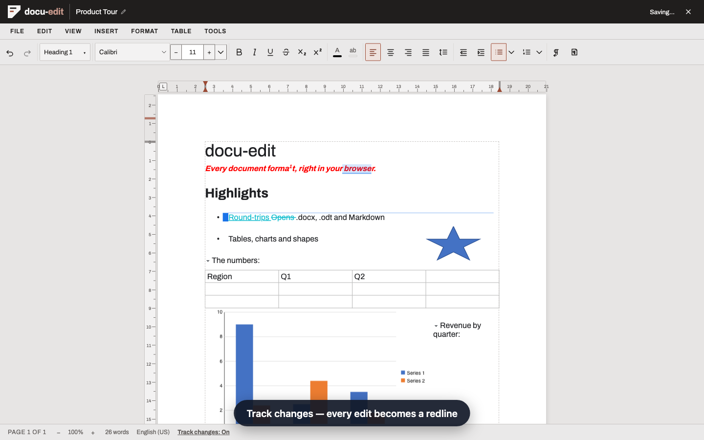
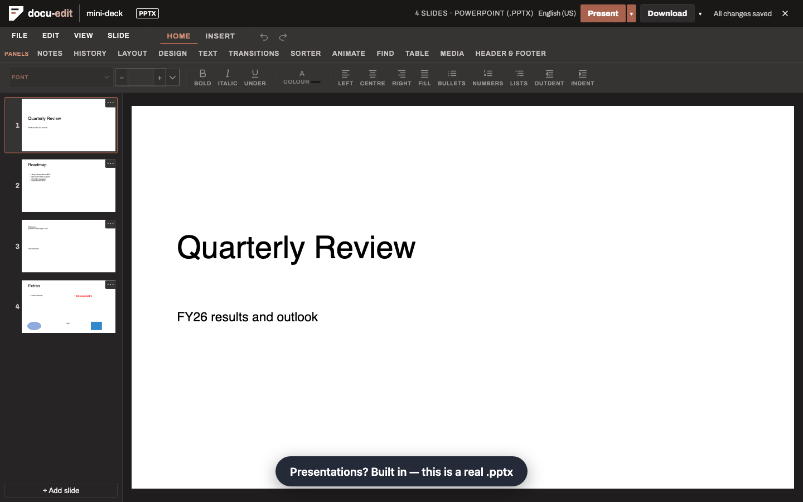
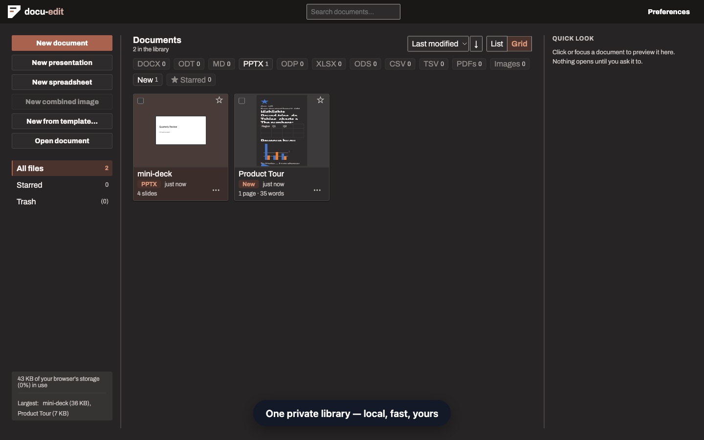
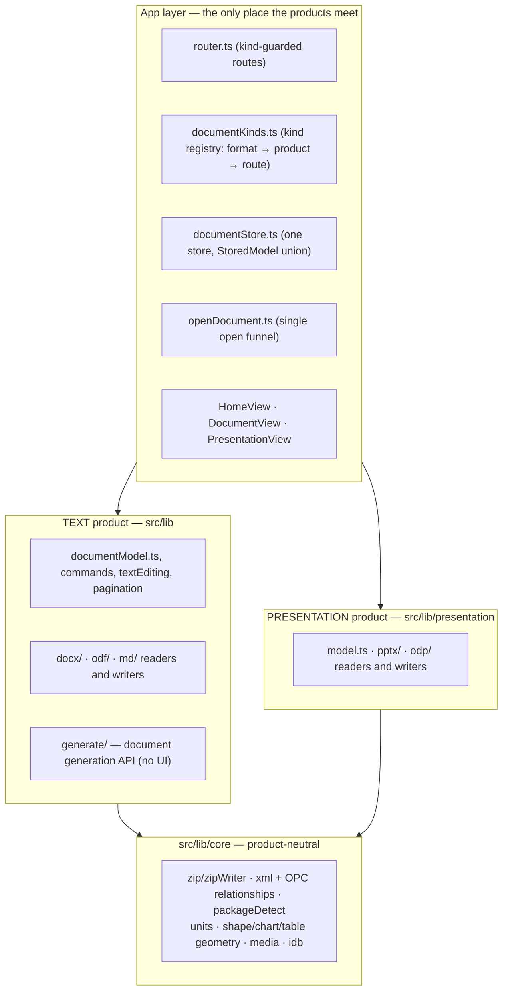
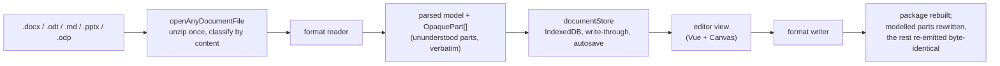

# docu-edit

A browser-based office suite. It opens, edits and saves documents in the
formats people actually have — `.docx` (OOXML), `.odt` (ODF) and Markdown —
plus presentations (`.pptx`/`.odp`), with round-trip fidelity as the first
priority: content the app does not understand is preserved verbatim, never
discarded. Everything runs locally in the browser; there is no server.

## Products

- **Word processor** (`/doc/:id`) — rich text editing, character and
  paragraph formatting, styles, lists, tables, images, hyperlinks, page
  layout (size/margins/orientation, breaks, headers/footers, columns,
  footnotes), table of contents, fields, shapes and charts, find & replace,
  spell check, comments, track changes, version history, print/PDF export,
  mail merge and a document generation API.
- **Presentations** (`/slides/:id`) — slide canvas, filmstrip, text and
  object editing, speaker notes, slideshow playback (`/slides/:id/present/:n`),
  transitions, animations, layouts, deck setup and HTML export.
- **Library** (`/`) — the landing page that lists, creates, opens,
  drag-and-drops and searches your locally stored documents and decks;
  documents can also be opened from a URL (`/open`).

The feature set is built spec-by-spec. The specs and their roadmap, the full
intended order, live in a separate private repository. Code comments that cite
`specs/NNN-….md` refer to it.

## Product tour

Screenshots from the automated product tour (`e2e/demo/demo.tour.ts`), kept
in `docs/images/`. To regenerate the full shot set and the recorded video, run
`DEMO_SHOTS=1 npx playwright test --config=playwright.demo.config.ts demo.tour.ts`.
It writes them to the gitignored `demo-results/`.

### Word processor


*Built for review — inline comments and track changes, where every edit
becomes a redline you can accept or reject.*

### Presentations


*Presentations are built in — a real `.pptx` with filmstrip, slide
management, speaker notes and slideshow playback.*

### Library


*One private library for documents and decks — local, fast, yours. No
install, no account; files stay on your machine.*

## Tech stack

- [Vue 3](https://vuejs.org/) (`<script setup lang="ts">`, Composition API) + TypeScript strict mode
- [Vite](https://vitejs.dev/) for dev server and build
- HTML Canvas for page/slide rendering and complex shapes
- No runtime dependencies beyond `vue` and `vue-router`
- Testing: [Vitest](https://vitest.dev/) + `@vue/test-utils` (unit), [Playwright](https://playwright.dev/) 1.63.0 (e2e)
- Linting: [OXLint](https://oxc.rs/docs/guide/usage/linter.html) for `.ts`, ESLint (`eslint-plugin-vue`) for `.vue` templates

## Getting started

```sh
npm install
npm run dev        # dev server on http://localhost:5173
```

## Commands

| Task | Command |
| --- | --- |
| Dev server | `npm run dev` |
| Build (typecheck + bundle) | `npm run build` |
| Unit tests | `npm test` |
| E2E tests | `npx playwright test` |
| Typecheck | `npm run typecheck` |
| Lint | `npm run lint` |

## Layout

```
src/
  main.ts / App.vue    app entry and root shell
  router.ts            route table
  views/               one component per route (editor, library, slides)
    document/          the text editor's composables
    library/           product-neutral library UI
  components/          reusable UI (dialogs, panes, toolbars)
  lib/                 framework-free logic — parsers, writers, converters
    core/              product-neutral layer shared by all products
    docx/ odf/ md/     word processor format readers/writers
    presentation/      presentation (.pptx/.odp) readers/writers
    generate/          document generation API (no UI)
e2e/                   Playwright specs, one per feature (SPEC-NNN.spec.ts)
docs/                  architecture and feature documentation
examples/              runnable generation-API examples (invoice, letter, report)
```

All document parsing and serialisation lives in `src/lib/` as plain
TypeScript with no Vue imports, so it is unit-testable and reusable
headlessly.

## Architecture

The repo is layered so two products (word processor and presentations) share
one engine without importing each other. A third product (images/PDFs) is
planned as a third box on the same diagram.



Layer boundaries are enforced as tests, not conventions:
`core/boundary.spec.ts` (core imports only core siblings; format layers never
import each other or Vue) and `presentation/boundary.spec.ts` (presentation
imports only presentation + core, never the text product).

Opening and saving a file:



Detection never trusts file extensions — `core/packageDetect` classifies the
unzipped container (ODF `mimetype`, OPC main part), and the router guards
redirect an id of the wrong kind (`/doc/:id` ↔ `/slides/:id`).

## Key decisions

- **Round-trip fidelity beats feature count.** Content the app does not
  parse is kept as opaque parts and re-emitted byte-identical on save
  (SPEC-008); round-trip tests assert part-level byte equality.
- **Products never import each other.** Anything both products need is
  product-neutral by definition and lives in `src/lib/core`; the products
  compose only in the app layer (`documentKinds.ts`, `openDocument.ts`,
  `documentStore.ts`, router, views). See
  [docs/presentations-architecture.md](docs/presentations-architecture.md).
- **One store, model union.** `StoredModel = DocumentModel | PresentationModel`
  shares persistence (write-through, drafts, trash, storage accounting) by
  construction; kind-narrowed accessors keep text and decks from leaking
  into each other.
- **Logic is framework-free.** All parsing, serialisation and document
  logic is plain TypeScript in `src/lib/` — unit-testable without mounting
  a component and reusable headlessly (e.g. the generation API in
  `examples/`).
- **Spec-driven development.** Every feature is one spec, shippable on its
  own, with its own Playwright file (`e2e/SPEC-NNN.spec.ts`). The specs live in
  a separate repository, and its roadmap fixes the order.
- **Locked dependency set.** `package.json` gains no dependencies from
  feature work; the app ships on `vue` + `vue-router` alone, and Canvas is
  used wherever DOM is a poor fit. Playwright is pinned to 1.63.0, in
  lockstep with the CI container's base image — the two move together or
  every e2e test fails.
- **Size ratchets, not refactors on a whim.** Wiring hubs (`DocumentView`,
  `HomeView`) have line budgets that only ratchet down — when a budget
  fails, code is extracted into composables/components, never the budget
  raised. Existing tests are never weakened or deleted to make a change pass.

## Documentation

- [docs/presentations-architecture.md](docs/presentations-architecture.md) — the presentation product's architecture
- [docs/generate-api.md](docs/generate-api.md) — generating `.docx`/`.odt` files from code or JSON
- [docs/mail-merge.md](docs/mail-merge.md) — mail merge and templates
- [src/lib/core/README.md](src/lib/core/README.md) — the product-neutral layer shared by both products
- [CLAUDE.md](CLAUDE.md) — conventions and commands for AI coding agents
