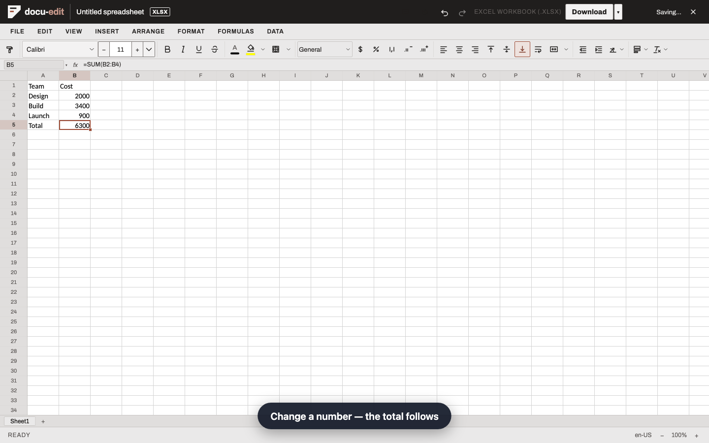
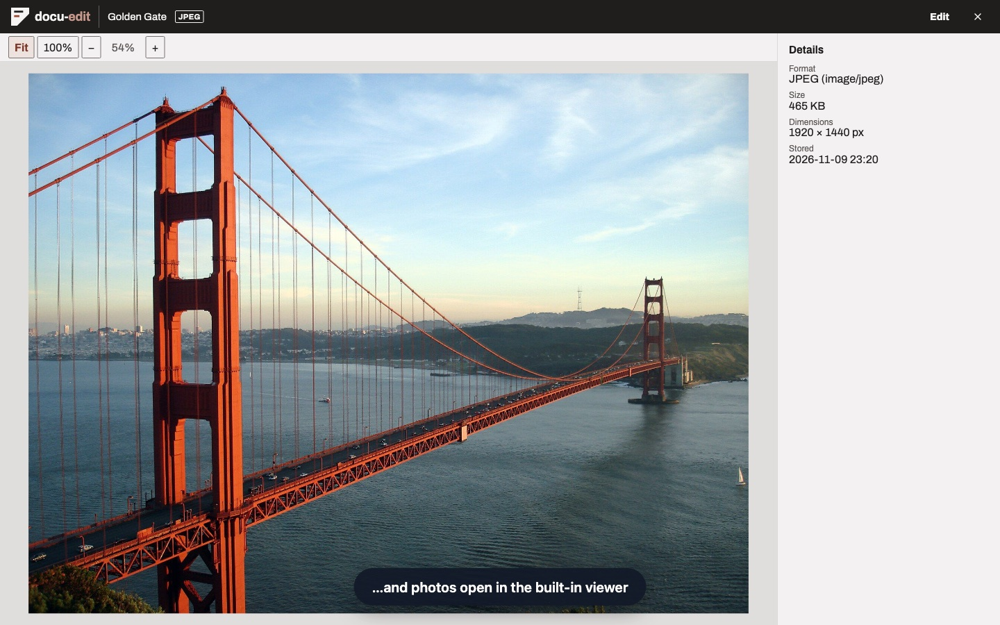
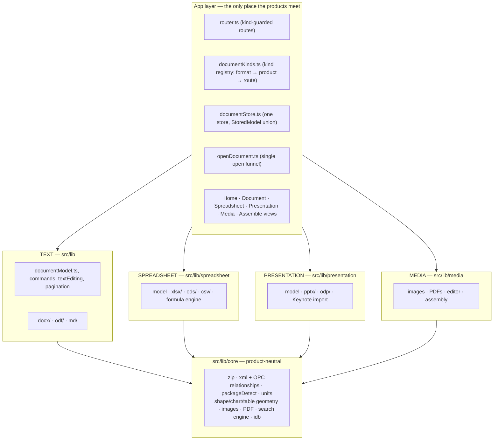
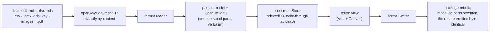

# docu-edit

A browser-based office suite: documents, spreadsheets, presentations, and
images and PDFs, in one app and one library. It opens, edits and saves the
formats people actually have: Word and OpenDocument text, Markdown, Excel and
OpenDocument workbooks, CSV, PowerPoint and OpenDocument decks. Round-trip
fidelity comes first: content the app does not understand is preserved
verbatim, never discarded.

Everything runs locally in the browser. There is no backend and no account,
and your files stay in your browser's storage and are never uploaded. The only
code that can send your content anywhere is an experimental feature. It is off
by default and talks to a model endpoint only after you configure one and
approve the request.

## Products

- **Word processor** (`/doc/:id`): rich text editing, character and
  paragraph formatting, styles and a custom-styles manager, document themes,
  bulleted, numbered and multilevel lists, tables (styles, header repeat,
  sort, text↔table conversion), images, hyperlinks and bookmarks, special
  characters, and equations.
  - **Page layout:** size, margins and orientation; page and section breaks;
    headers, footers and page numbers; columns; tab stops and rulers;
    paragraph and page borders.
  - **Long documents:** footnotes and endnotes, a table of contents, captions
    and a table of figures, and fields with cross-references.
  - **Drawing:** shapes (a full catalogue with adjustment handles), freeform
    curves, connectors, text boxes, groups, align and distribute, and charts.
  - **Review:** spell check (English, German, French, Spanish and Czech, plus
    your own dictionaries), comments, track changes, version history, an
    accessibility checker, word count and an outline navigator.
  - **Output and automation:** print and PDF export, font embedding,
    templates and mail merge, and a document generation API.
- **Spreadsheets** (`/sheets/:id`): a sheet grid with styles, merges, frozen
  panes and multi-sheet workbooks.
  - **Formulas:** a calculation engine with 300+ functions, a function
    picker, and point-and-click references. Formulas are translated between
    the Excel and OpenDocument dialects.
  - **Formatting and editing:** number formats and dates, cell formatting,
    and copy, paste, fill and move.
  - **Data:** sort and filter, conditional formatting, data validation with
    in-cell dropdowns, and named ranges and tables.
  - **On the sheet:** images, shapes and charts, plus cell notes, comments
    and hyperlinks.
  - **Navigation and output:** find and replace, Go To, page setup, printing
    and PDF export.
  - **Under the hood:** autosave and version history, large-workbook
    performance, and a workbook generation API.
- **Presentations** (`/slides/:id`): a slide canvas and filmstrip, layouts,
  deck setup, and themes.
  - **On a slide:** text with lists and autofit; images, shapes, tables,
    charts, and audio and video.
  - **Arranging:** rotation, groups, align and distribute, and a slide sorter
    with sections and slide reuse.
  - **Every slide:** footers, slide numbers and dates; speaker notes; find
    and replace and spell check.
  - **Showing it:** transitions and animations (entrance, exit, emphasis and
    motion paths), slideshow playback (`/slides/:id/present/:n`), and a
    presenter view with notes, the next slide and a show timer
    (`/slides/:id/presenter/:n`).
  - **Export and automation:** self-contained HTML, PDF, images and handouts,
    autosave and version history, Keynote import, and a presentation
    generation API that also turns Markdown into slides.
- **Images and PDFs** (`/media/:id`, `/assemble`): images and PDFs live in
  the library beside everything else.
  - **Viewer and editor:** a photo and PDF viewer, and an image editor that
    can straighten, crop, rotate, flip, resize, adjust, redact and annotate.
  - **Assembly:** combine images into one image, assemble images into a PDF,
    and merge PDFs and reorder their pages.
- **Library** (`/`): the landing page that lists, creates, opens and searches
  everything you have stored.
  - **Browsing:** grid and list views, filters by format, starred files, and
    a trash with undo.
  - **Opening:** Quick Look previews, drag and drop, open from a URL
    (`/open`), and new files from templates.
  - **Settings:** a storage meter, and preferences with colour palettes and
    dark mode.
- **Labs** (experimental, off until switched on in Preferences): full-text
  search inside your documents, decks and PDFs, and a deck designer that
  drafts a presentation from a description. The deck designer works with any
  OpenAI-compatible endpoint you configure, local or hosted. Nothing is
  preconfigured. Before anything goes to an endpoint you have not approved,
  you are shown the exact request.

## Formats

| Product | Opens | Saves and exports |
| --- | --- | --- |
| Word processor | `.docx`, `.odt`, `.md` | `.docx`, `.odt`, `.md`, PDF |
| Spreadsheets | `.xlsx` (and `.xlsm`, `.xltx`, `.xltm`), `.ods` (and `.ots`), `.csv`, `.tsv` | its own format, a copy in another, PDF |
| Presentations | `.pptx`, `.odp`, Keynote `.key` (import) | `.pptx`, `.odp`, HTML, PDF, images, handouts |
| Images and PDFs | `.png`, `.jpg`, `.gif`, `.svg`, `.webp`, `.pdf` | the edited image, a combined image, images as a PDF, merged PDFs |

When a save cannot carry everything, for example Markdown or CSV, a
conversion report lists exactly what was left out.

## Product tour

Screenshots from the automated product tours (`e2e/demo/`), kept in
`docs/images/`. To regenerate them and the recorded videos, run
`DEMO_SHOTS=1 npx playwright test --config=playwright.demo.config.ts`. It
writes them to the gitignored `demo-results/`.

### Word processor


*Built for review: inline comments and track changes, where every edit
becomes a redline you can accept or reject.*

### Spreadsheets


*Real `.xlsx` workbooks with a calculation engine: change a number and the
total follows.*

### Presentations


*A real `.pptx` with filmstrip, slide management, speaker notes and slideshow
playback.*

### Images and PDFs


*Photos and PDFs open in the built-in viewer. The image editor and the
assembly sheet turn them into new images and PDFs.*

### Library


*One private library for documents, workbooks, decks, PDFs and images. Quick
Look previews before anything opens. No install, no account, and files stay
on your machine.*

## Tech stack

- [Vue 3](https://vuejs.org/) (`<script setup lang="ts">`, Composition API)
  with TypeScript in strict mode, and [vue-router](https://router.vuejs.org/)
- [Vite](https://vitejs.dev/) for the dev server and the build
- HTML Canvas for page and slide rendering, shapes, charts and image editing
- Web Workers for spell check, word count, the library search index and
  workbook parsing
- IndexedDB for the library: write-through autosave, drafts, trash and
  version history
- Four runtime dependencies: `vue`, `vue-router`, `pdfjs-dist` (PDF
  previews, loaded lazily) and `wordlist-english` (English spell-check word
  lists)
- Testing: [Vitest](https://vitest.dev/) + `@vue/test-utils` (unit) and
  [Playwright](https://playwright.dev/) 1.63.0 (e2e)
- Linting: [OXLint](https://oxc.rs/docs/guide/usage/linter.html) for `.ts`,
  ESLint (`eslint-plugin-vue`) for `.vue` templates

## Getting started

```sh
npm install
npm run dev        # dev server on http://localhost:5173
```

## Commands

| Task | Command |
| --- | --- |
| Dev server | `npm run dev` |
| Build (typecheck + bundle) | `npm run build` |
| Unit tests | `npm test` |
| E2E tests | `npx playwright test` |
| Typecheck | `npm run typecheck` |
| Lint | `npm run lint` |
| Product tours (headed, recorded) | `npx playwright test --config=playwright.demo.config.ts` |

## Layout

```
src/
  main.ts / App.vue    app entry and root shell
  router.ts            route table
  views/               one component per route: Home, Document, Spreadsheet,
                       Presentation (+ Play, Presenter), Media, Assemble, OpenFromUrl
    document/ spreadsheet/ presentation/ media/ assemble/ library/ …
                       each view's composables and panels
  components/          reusable UI (dialogs, panes, toolbars, menus)
  workers/             spell check, word count, library index, workbook parsing
  lib/                 framework-free logic: parsers, writers, converters
    core/              product-neutral layer shared by every product
    docx/ odf/ md/     word processor format readers and writers
    spreadsheet/       workbook model, .xlsx/.ods/CSV, formula engine
    presentation/      deck model, .pptx/.odp/Keynote readers and writers
    media/             images and PDFs: model, editor renderer, assembly
    math/              equations
    spellcheck/        checker and dictionaries
    fonts/             font fallback, subsetting and embedding
    generate/          document, deck and workbook generation APIs (no UI)
    ai/ design/        Labs: the model gateway and the deck designer
e2e/                   Playwright specs, one per feature (SPEC-NNN.spec.ts)
  demo/                the product tours (*.tour.ts)
docs/                  architecture, API and feature documentation
examples/              runnable generation-API examples
scripts/               fixture builders
```

All document parsing and serialisation lives in `src/lib/` as plain
TypeScript with no Vue imports, so it is unit-testable and reusable
headlessly.

## Architecture

The repo is layered so four products share one engine without importing
each other.



Layer boundaries are enforced as tests, not conventions. Each layer has a
`boundary.spec.ts`:

- `core` imports only core, and format layers never import each other or Vue.
- `presentation`, `spreadsheet` and `media` each import only themselves and
  core, never another product.
- `design`, the deck designer, imports only presentation, core and the deck
  generators. It is handed the model's reply as plain data, never calls the
  model gateway, and reaches no network.
- `ai/boundary.spec.ts` allows exactly five network call sites. The model
  gateway is the only one that talks to a model. The others reach the app's
  own files or a URL you supplied, such as open from URL or a remote image in
  a Markdown file.

Opening and saving a file:



Detection never trusts file extensions. `core/packageDetect` classifies the
unzipped container (ODF `mimetype`, OPC main part), and the router's guards
redirect an id opened under the wrong product's route to the right one.

## Key decisions

- **Round-trip fidelity beats feature count.** Content the app does not
  parse is kept as opaque parts and re-emitted byte-identical on save
  (SPEC-008), and round-trip tests assert part-level byte equality. A
  conversion that cannot carry everything says what it dropped.
- **Products never import each other.** Anything two products need is
  product-neutral by definition and lives in `src/lib/core`. The products
  compose only in the app layer (`documentKinds.ts`, `openDocument.ts`,
  `documentStore.ts`, the router and the views). See
  [docs/presentations-architecture.md](docs/presentations-architecture.md).
- **One store, model union.**
  `StoredModel = DocumentModel | PresentationModel | MediaModel | SpreadsheetModel`
  shares persistence (write-through, drafts, trash, version history, storage
  accounting) by construction. Kind-narrowed accessors keep the products'
  models from leaking into each other.
- **Logic is framework-free.** All parsing, serialisation and document logic
  is plain TypeScript in `src/lib/`. It is unit-testable without mounting a
  component and reusable headlessly, as the generation APIs in `examples/`
  show.
- **Local first, and no telemetry.** Documents never leave the browser. Apart
  from the interface's web fonts, the app fetches only what you point it at.
  The Labs model gateway (`src/lib/ai`) is the only code that sends content
  out, and only for a feature you switched on, to an endpoint you configured,
  after you see the exact request.
- **Spec-driven development.** Every feature is one spec, shippable on its
  own, with its own Playwright file (`e2e/SPEC-NNN.spec.ts`). The specs live
  in a separate repository, and its roadmap fixes the order. Code comments
  that cite `specs/NNN-….md` refer to it.
- **Locked dependency set.** `package.json` gains no dependencies from
  feature work. The only additions beyond `vue` and `vue-router` were
  approved one by one, and Canvas is used wherever the DOM is a poor fit.
  Playwright is pinned to 1.63.0, in lockstep with the CI container's base
  image: the two move together or every e2e test fails.
- **Size ratchets, not refactors on a whim.** Wiring hubs (`DocumentView`,
  `HomeView` and the other product views) have line budgets that only
  ratchet down. When a budget fails, code is extracted into composables or
  components, and the budget is never raised. Existing tests are never
  weakened or deleted to make a change pass.

## Generating files from code

Each product has a headless builder in `src/lib/generate`, with runnable
examples:

| API | Docs | Examples |
| --- | --- | --- |
| Documents (`.docx`/`.odt`) | [docs/generate-api.md](docs/generate-api.md) | `node examples/invoice.js`, `letter.js`, `report.js` |
| Presentations (`.pptx`/`.odp`, Markdown to slides) | [docs/generate-deck-api.md](docs/generate-deck-api.md) | `node examples/deck.js`, `slides-from-markdown.js` |
| Workbooks (`.xlsx`/`.ods`) | [docs/generate-workbook-api.md](docs/generate-workbook-api.md) | `node examples/sales-report.js`, `csv-to-xlsx.js`, `budget.js` |

## Documentation

- [docs/presentations-architecture.md](docs/presentations-architecture.md):
  the layering every product follows, worked through for presentations
- [docs/generate-api.md](docs/generate-api.md),
  [docs/generate-deck-api.md](docs/generate-deck-api.md),
  [docs/generate-workbook-api.md](docs/generate-workbook-api.md): the
  generation APIs
- [docs/mail-merge.md](docs/mail-merge.md): mail merge and templates
- [src/lib/core/README.md](src/lib/core/README.md): the product-neutral layer
  shared by every product
- [CLAUDE.md](CLAUDE.md): conventions and commands for AI coding agents
